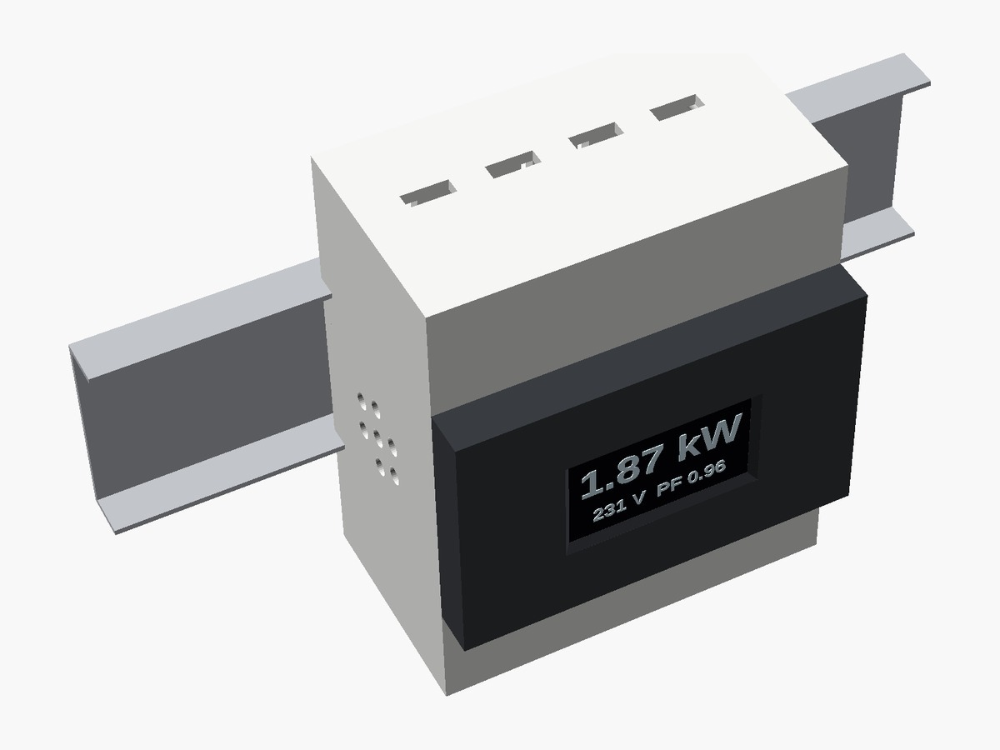
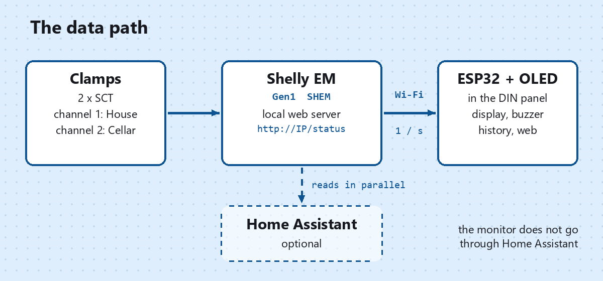

# DIN-rail energy monitor with ESP32 reading a Shelly EM directly

> 📖 **Full article with step-by-step explanations (in Italian):**  
> **[DIN-rail energy monitor with ESP32 reading a Shelly EM directly, without Home Assistant – www.emgi.it](https://www.emgi.it/2026/10/13/monitor-consumi-barra-din-esp32-shelly-em-senza-home-assistant/)**
>
> More electronics, Arduino, ESP32, Home Assistant and 3D printing projects at **[www.emgi.it](https://www.emgi.it)**

An **ESP32** with a **1.3" SH1106 OLED** display inside a 3D-printed **4-module DIN-rail enclosure** that queries the **Shelly EM** directly on the local network, **without Home Assistant** in between. It shows the real-time power consumption and the mains voltage right in the electrical panel, keeps a kWh history and sounds an alarm when the threshold is exceeded.

It is the second version of the project [din-power-monitor-esp32-oled-home-assistant](https://github.com/snckwf/din-power-monitor-esp32-oled-home-assistant): **same hardware and same enclosure**, different firmware. For installing the Shelly EM in the panel see [Shelly EM with current clamps](https://www.emgi.it/2026/10/09/shelly-em-home-assistant-pinze-amperometriche/) (in Italian).

## What it does

- **instantaneous power** of the total and of the two branches, read from the Shelly EM **every second** with a single `GET /status`
- **mains voltage** and **power factor** of the two channels
- **three pages** rotating every 5 seconds: total in large digits with a 0–4 kW bar, the two branches (with the voltage in the header), today's and this month's energy with the daily peak
- **overload alarm**: two-tone siren on the buzzer, display locked on the total page and flashing in negative, 100 W hysteresis
- **daily maximum peak** with value and time
- **kWh history**: 31 days and 12 months on LittleFS, calculated as the difference of the Shelly cumulative counters (`total`, in Wh), with automatic realignment if the counter restarts from zero
- **web page** with live values, daily and monthly bar charts (SVG, no external libraries) and threshold adjustment without recompiling
- **JSON API** `/api/live` and `/api/storico` (history)
- **OTA update** with a percentage on the display
- **date and time taken from the Shelly** (`unixtime`), with NTP as a fallback; Italian time zone and daylight saving time preset (change `FUSO_ORARIO` for your country)
- **OFFLINE** screen after three consecutive failed readings, with the Shelly IP and the Wi-Fi status
- **no dependency** on Home Assistant, the Shelly cloud or the Internet

## Parts used

- **First-generation Shelly EM** (type `SHEM`) with its two clamps, already installed and connected to Wi-Fi
- 30-pin ESP32 DevKit (PCBA 28 × 50 mm)
- **SH1106 1.3" 128×64 I2C** OLED display (address 0x3C, 0x3D on some clones)
- LS3040 **passive** piezo buzzer (⌀29.3 × 5 mm disc)
- 5 V power supply
- 3D-printed enclosure (3 parts, STL files in `case_3d/`)
- 5 M3 screws (the two on the buzzer side of the bezel with a **low cheese head**)

> ⚠️ **Gen2/Gen3** Shelly devices (Pro EM, EM Gen3) use the RPC API and are **not supported** by this sketch. To check your model open `http://SHELLY-IP/shelly`: it must show `"type":"SHEM"`.

## Wiring

Board: **30-pin ESP32 DevKit**. Pins checked against the sketch (`PIN_SDA 21`, `PIN_SCL 22`, `PIN_BUZZER 27`).

| ESP32 | Connected to |
|---|---|
| **GPIO 21** | **SDA** of the SH1106 display |
| **GPIO 22** | **SCK / SCL** of the SH1106 display |
| **3V3** | display **VDD** (the module has an on-board regulator, it also tolerates 5 V) |
| **GND** | display **VSS/GND**, buzzer **−** (common ground) |
| **GPIO 27** | **passive** buzzer **+** (PWM driven via LEDC) |
| **5V / USB** | 5 V power supply |

400 kHz I2C bus, no external pull-up resistors. The Shelly EM has **no physical connection** to the ESP32: they talk over Wi-Fi.

> ⚠️ **Display pad order.** Looking at the display **from the front**, the four pads at the top from left to right are `VSS – VDD – SCK – SDA`. **Seen from the back the order is reversed.**

> ⚠️ The buzzer must be **passive**: an active one would play a single note and the two-tone siren would not work.

## What it reads from the Shelly EM

One `GET http://<shelly>/status` per second. Fields used:

| Field | Use |
|---|---|
| `emeters[n].power` | instantaneous W of channel n |
| `emeters[n].voltage` | mains voltage |
| `emeters[n].pf` | power factor |
| `emeters[n].is_valid` | `false` if the clamp is not connected → the branch shows dashes |
| `emeters[n].total` | cumulative Wh → kWh history |
| `unixtime` | Shelly UTC time → clock and calendar |

The total is the sum of the valid channels. Parsing is done by hand on a few keys: no ArduinoJson, the only external library is U8g2.

## Configuration

At the top of the sketch, in the `CONFIGURATION` block:

| `#define` | Content |
|---|---|
| `WIFI_SSID`, `WIFI_PASSWORD` | Wi-Fi network (the same as the Shelly) |
| `SHELLY_HOST` | Shelly EM IP (better reserved in the router's DHCP) |
| `SHELLY_USER`, `SHELLY_PASS` | empty, unless *Restrict login* is enabled on the Shelly |
| `CANALE_1`, `CANALE_2` | `emeters[]` index of the first and second branch (0 and 1) |
| `USA_CANALE_2` | `0` with a single clamp: the display shows the voltage instead of the second branch |
| `NOME_1`, `NOME_2` | branch names, used on the display and the web page |
| `FUSO_ORARIO` | POSIX time-zone string, preset for Italy with daylight saving time |
| `OTA_PASSWORD` | password for network updates |

## The DIN-rail enclosure

The same as the Home Assistant version. **DIN 43880** standard, **4 modules**: 69.8 × 85 × 45 mm, spring clip for 35 mm DIN rail (EN 50022). Three parts, **no print supports**.

| Part | Print orientation |
|---|---|
| `bezel.stl` | face down |
| `body.stl` | front face down |
| `lid.stl` | flat on the bed, clips facing up |

Settings: PLA, 205 °C, bed 60 °C, 0.2 mm layers, 3 perimeters, 20% infill.

The parametric source is `case_3d/din_enclosure_display_esp32.scad`.

## Repository contents

| Path | Description |
|---|---|
| `shelly_power_monitor/shelly_power_monitor.ino` | Arduino sketch (credentials replaced by placeholders) |
| `case_3d/body.stl`, `bezel.stl`, `lid.stl` | The three parts to print |
| `case_3d/din_enclosure_display_esp32.scad` | Parametric OpenSCAD source |
| `images/` | Images |

## How to use it

1. Test the Shelly from your PC: `http://SHELLY-IP/status` must return the JSON with `emeters`.
2. Install the **U8g2** library by oliver (olikraus), version ≥ 2.34, from the Arduino IDE Library Manager. Wi-Fi, HTTPClient, WebServer, mDNS, LittleFS and OTA are already part of the ESP32 core.
3. Board **ESP32 Dev Module**, Flash 4 MB, Partition Scheme **"Default 4MB with spiffs (1.2MB APP / 1.5MB SPIFFS)"**.
4. Open [`shelly_power_monitor/shelly_power_monitor.ino`](shelly_power_monitor/shelly_power_monitor.ino) and fill in the placeholders: Wi-Fi SSID and password, Shelly IP and **OTA password**.
5. First upload over USB. From then on the ESP32 appears in *Tools → Port* as the network port `shelly-power-monitor`.
6. Print the three parts, solder the wires, assemble and clip it onto the DIN rail.
7. Open `http://shelly-power-monitor.local` for the charts and to set the alarm threshold (500–20000 W).

Compiled with ESP32 core **3.3.12** (the code also supports 2.x cores).

Step-by-step assembly, details and troubleshooting: **[article on www.emgi.it](https://www.emgi.it/2026/10/13/monitor-consumi-barra-din-esp32-shelly-em-senza-home-assistant/)** (in Italian).

## License

- Code and configuration: [MIT](LICENSE)
- 3D models, diagrams and images: [CC BY-SA 4.0](https://creativecommons.org/licenses/by-sa/4.0/)

---

**Author:** Massimiliano Sandrin – **[eMGi.it](https://www.emgi.it)** · Questions and comments below the [article on the website](https://www.emgi.it/2026/10/13/monitor-consumi-barra-din-esp32-shelly-em-senza-home-assistant/).
