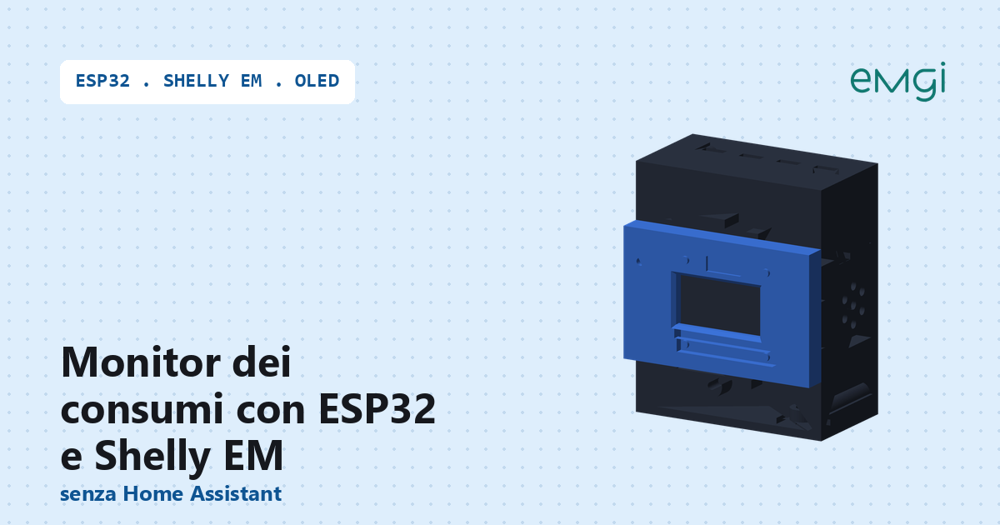
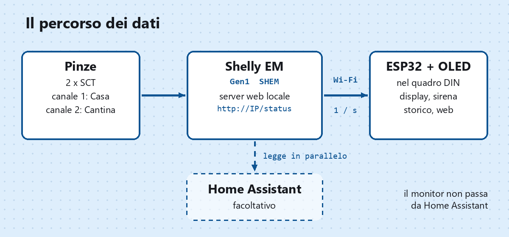
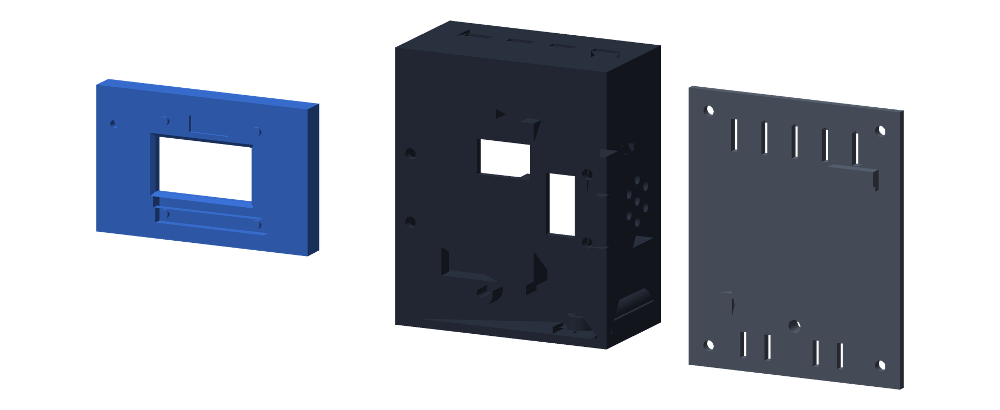
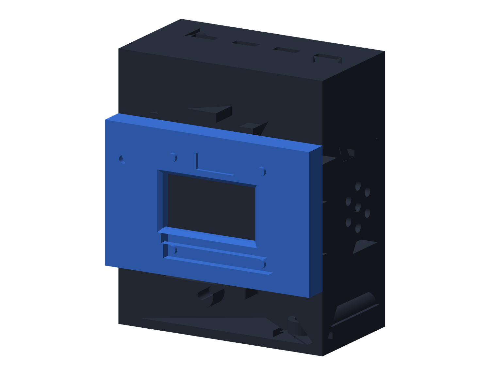

# Monitor dei consumi su barra DIN con ESP32 che legge direttamente lo Shelly EM

> 📖 **Articolo completo con spiegazioni passo passo:**  
> **[Monitor dei consumi su barra DIN con ESP32 che legge direttamente lo Shelly EM, senza Home Assistant – www.emgi.it](https://www.emgi.it/2026/10/13/monitor-consumi-barra-din-esp32-shelly-em-senza-home-assistant/)**
>
> Altri progetti di elettronica, Arduino, ESP32, Home Assistant e stampa 3D su **[www.emgi.it](https://www.emgi.it)**

Un **ESP32** con display **OLED SH1106 1,3"** dentro un contenitore da **barra DIN da 4 moduli** stampato in 3D, che interroga lo **Shelly EM** direttamente in rete locale, **senza Home Assistant** in mezzo. Mostra nel quadro elettrico la potenza assorbita in tempo reale, la tensione di rete, tiene lo storico dei kWh e suona quando si supera la soglia.

È la seconda versione del progetto [monitor-consumi-din-esp32-oled-home-assistant](https://github.com/snckwf/monitor-consumi-din-esp32-oled-home-assistant): **stesso hardware e stesso contenitore**, firmware diverso. Per l'installazione dello Shelly EM nel quadro vedi [Shelly EM con pinze amperometriche](https://www.emgi.it/2026/10/09/shelly-em-home-assistant-pinze-amperometriche/).

## Cosa fa il progetto

- **potenza istantanea** del totale e dei due rami, letta dallo Shelly EM **ogni secondo** con una sola `GET /status`
- **tensione di rete** e **fattore di potenza** dei due canali
- **tre pagine** che ruotano ogni 5 secondi: totale con cifre grandi e barra 0–4 kW, i due rami (con la tensione nell'intestazione), energia di oggi e del mese con il picco giornaliero
- **allarme sovraccarico**: sirena bitonale sul buzzer, display bloccato sulla pagina del totale e lampeggiante in negativo, isteresi di 100 W
- **picco massimo giornaliero** con valore e ora
- **storico kWh**: 31 giorni e 12 mesi su LittleFS, calcolati per differenza dai contatori cumulativi dello Shelly (`total`, in Wh), con riallineamento automatico se il contatore riparte da zero
- **pagina web** con valori live, grafici a barre giornalieri e mensili (SVG senza librerie esterne) e regolazione della soglia senza ricompilare
- **API JSON** `/api/live` e `/api/storico`
- **aggiornamento OTA** con percentuale sul display
- **data e ora prese dallo Shelly** (`unixtime`), con NTP di riserva; fuso italiano e ora legale già impostati
- schermata **OFFLINE** dopo tre letture fallite di fila, con l'IP dello Shelly e lo stato del Wi-Fi
- **nessuna dipendenza** da Home Assistant, dal cloud Shelly o da Internet

## Componenti utilizzati

- **Shelly EM di prima generazione** (tipo `SHEM`) con le sue due pinze, già installato e collegato al Wi-Fi
- ESP32 DevKit 30 pin (PCBA 28 × 50 mm)
- display OLED **SH1106 1,3" 128×64 I2C** (indirizzo 0x3C, su alcuni cloni 0x3D)
- buzzer piezo **passivo** LS3040 (disco ⌀29,3 × 5 mm)
- alimentatore 5 V
- contenitore stampato in 3D (3 pezzi, STL in `case_3d/`)
- 5 viti M3 (le due della fascia sul lato buzzer a **testa cilindrica bassa**)

> ⚠️ Gli Shelly **Gen2/Gen3** (Pro EM, EM Gen3) usano le API RPC e **non sono supportati** da questo sketch. Per verificare il modello apri `http://IP-DELLO-SHELLY/shelly`: deve comparire `"type":"SHEM"`.

## Collegamenti elettrici

Scheda: **ESP32 DevKit 30 pin**. Pin verificati sullo sketch (`PIN_SDA 21`, `PIN_SCL 22`, `PIN_BUZZER 27`).

| ESP32 | Collegato a |
|---|---|
| **GPIO 21** | **SDA** del display SH1106 |
| **GPIO 22** | **SCK / SCL** del display SH1106 |
| **3V3** | **VDD** del display (il modulo ha il regolatore a bordo, regge anche 5 V) |
| **GND** | **VSS/GND** del display, **−** del buzzer (massa comune) |
| **GPIO 27** | **+** del buzzer **passivo** (pilotato in PWM tramite LEDC) |
| **5V / USB** | alimentatore 5 V |

Bus I2C a 400 kHz, nessuna resistenza di pull-up esterna. Lo Shelly EM **non ha collegamenti fisici** con l'ESP32: comunicano via Wi-Fi.

> ⚠️ **Ordine dei pad del display.** Guardando il display **da davanti**, i quattro pad in alto da sinistra a destra sono `VSS – VDD – SCK – SDA`. **Visto da dietro l'ordine è invertito.**

> ⚠️ Il buzzer deve essere **passivo**: uno attivo suonerebbe una nota sola e la sirena bitonale non funzionerebbe.

## Cosa legge dallo Shelly EM

Una `GET http://<shelly>/status` al secondo. I campi usati:

| Campo | Uso |
|---|---|
| `emeters[n].power` | W istantanei del canale n |
| `emeters[n].voltage` | tensione di rete |
| `emeters[n].pf` | fattore di potenza |
| `emeters[n].is_valid` | `false` se la pinza non è collegata → il ramo mostra i trattini |
| `emeters[n].total` | Wh cumulativi → storico kWh |
| `unixtime` | ora UTC dello Shelly → orologio e calendario |

Il totale è la somma dei canali validi. Il parsing è fatto a mano su poche chiavi: niente ArduinoJson, l'unica libreria esterna è U8g2.

## Configurazione

In cima allo sketch, blocco `CONFIGURAZIONE`:

| `#define` | Contenuto |
|---|---|
| `WIFI_SSID`, `WIFI_PASSWORD` | rete Wi-Fi (la stessa dello Shelly) |
| `SHELLY_HOST` | IP dello Shelly EM (meglio riservato nel DHCP del router) |
| `SHELLY_USER`, `SHELLY_PASS` | vuoti, a meno che sullo Shelly sia attivo *Restrict login* |
| `CANALE_1`, `CANALE_2` | indice di `emeters[]` del primo e del secondo ramo (0 e 1) |
| `USA_CANALE_2` | `0` con una sola pinza: al posto del secondo ramo il display mostra la tensione |
| `NOME_1`, `NOME_2` | nomi dei rami, usati su display e pagina web |
| `FUSO_ORARIO` | stringa POSIX, già impostata per l'Italia con l'ora legale |
| `OTA_PASSWORD` | password per l'aggiornamento via rete |

## Il contenitore da barra DIN

Lo stesso della versione con Home Assistant. Norma **DIN 43880**, **4 moduli**: 69,8 × 85 × 45 mm, aggancio a molla per barra DIN 35 mm (EN 50022). Tre pezzi, **nessun supporto di stampa**.

| Pezzo | Orientamento di stampa |
|---|---|
| `fascia.stl` | a faccia in giù |
| `corpo.stl` | con il fronte in giù |
| `coperchio.stl` | piano sul letto, clip verso l'alto |

Parametri: PLA, 205 °C, piatto 60 °C, layer 0,2 mm, 3 perimetri, riempimento 20%.

Il sorgente parametrico è in `case_3d/supporto_din_display_esp32.scad`.

## Contenuto del repository

| Percorso | Descrizione |
|---|---|
| `monitor_potenza_shelly/monitor_potenza_shelly.ino` | Sketch Arduino (credenziali sostituite da segnaposto) |
| `case_3d/corpo.stl`, `fascia.stl`, `coperchio.stl` | I tre pezzi da stampare |
| `case_3d/supporto_din_display_esp32.scad` | Sorgente parametrico OpenSCAD |
| `immagini/` | Immagini dell'articolo |

## Come si usa

1. Prova lo Shelly dal PC: `http://IP-DELLO-SHELLY/status` deve restituire il JSON con `emeters`.
2. Installa la libreria **U8g2** di oliver (olikraus), versione ≥ 2.34, dal Gestore librerie dell'IDE Arduino. Wi-Fi, HTTPClient, WebServer, mDNS, LittleFS e OTA sono già nel core ESP32.
3. Scheda **ESP32 Dev Module**, Flash 4 MB, Partition Scheme **"Default 4MB with spiffs (1.2MB APP / 1.5MB SPIFFS)"**.
4. Apri [`monitor_potenza_shelly/monitor_potenza_shelly.ino`](monitor_potenza_shelly/monitor_potenza_shelly.ino) e compila i segnaposto: SSID e password Wi-Fi, IP dello Shelly e **password OTA**.
5. Primo caricamento via USB. Dai successivi l'ESP32 compare in *Strumenti → Porta* come porta di rete `monitor-potenza-shelly`.
6. Stampa i tre pezzi, salda i fili, monta e aggancia alla barra DIN.
7. Apri `http://monitor-potenza-shelly.local` per i grafici e per impostare la soglia di allarme (500–20000 W).

Compilato con core ESP32 **3.3.12** (il codice gestisce anche i core 2.x).

Montaggio passo passo, dettagli e risoluzione dei problemi: **[articolo su www.emgi.it](https://www.emgi.it/2026/10/13/monitor-consumi-barra-din-esp32-shelly-em-senza-home-assistant/)**.

## Licenza

- Codice e configurazioni: [MIT](LICENSE)
- Modelli 3D, schemi e immagini: [CC BY-SA 4.0](https://creativecommons.org/licenses/by-sa/4.0/deed.it)

---

**Autore:** Massimiliano Sandrin – **[eMGi.it](https://www.emgi.it)** · Domande e commenti sotto l'[articolo sul sito](https://www.emgi.it/2026/10/13/monitor-consumi-barra-din-esp32-shelly-em-senza-home-assistant/).
